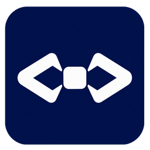

# Good Manners



Shared development conventions for Codex, with task-specific guidance for Web, React, Rust, C#, and databases.

Version: **0.1.1**. Skill name: **`good-manners`**.

## Installation

### Codex marketplace

Add [this Git repository](https://github.com/alexey-potory/good-manners) through Codex's **Add plugin marketplace** action, select the Git ref containing the package (currently `master`), then install **Good Manners** from that marketplace.

The repository includes a [marketplace catalog](.agents/plugins/marketplace.json), a [Codex plugin manifest](.codex-plugin/plugin.json), and the complete skill at [`skills/good-manners/`](skills/good-manners/SKILL.md). The marketplace's local source path resolves relative to the repository root.

Commit and push packaging changes before retrying a Git-backed installation: local edits are not included in the remote checkout. Leave sparse paths unset, or include `.agents/plugins`, `.codex-plugin`, and `skills` when using sparse checkout.

### Standalone skill

Copy only the `skills/good-manners` directory into your Codex skills directory. Use `$CODEX_HOME/skills` when configured, or the default `~/.codex/skills` location.

Keep its `SKILL.md`, `agents/`, `references/`, and `assets/` together. When using `skill-installer`, select the `skills/good-manners` path in this repository.

Neither installation method automatically installs external skills, plugins, or application packages.

## Usage

For a marketplace installation, select the installed Good Manners plugin and describe your task. For a standalone installation, invoke `$good-manners`, followed by your task. Automatic skill selection remains enabled.

```text
Use $good-manners to review the changes in this project.
Use $good-manners to audit missing skills for React and PostgreSQL.
Use $good-manners to install only the missing skills for Rust unsafe-code work.
```

User requirements and project-specific instructions take precedence over skill defaults.

## Modules

| Module                                                         | Purpose                                                                  |
| -------------------------------------------------------------- | ------------------------------------------------------------------------ |
| [Shared conventions](skills/good-manners/SKILL.md)             | Scope, language, code layout, review, verification, and Git conventions  |
| [Installation](skills/good-manners/references/installation.md) | Dependency inventory and selective setup by stack and capability         |
| [Web](skills/good-manners/references/web.md)                   | Browser guidance, themes, localization, formatting, linting, and testing |
| [React](skills/good-manners/references/react.md)               | React-specific components, bindings, linting, and tests                  |
| [Rust](skills/good-manners/references/rust.md)                 | Rust skills, formatting, and Clippy                                      |
| [C#](skills/good-manners/references/csharp.md)                 | C# skills, formatting, and analyzers                                     |
| [Databases](skills/good-manners/references/database.md)        | PostgreSQL and Supabase access, migrations, and permissions              |

The main skill loads only the modules relevant to a task. These modules are references inside one skill, rather than separately registered skills.

## Dependencies

Good Manners references external skills and plugins without bundling them. Use the [installation module](skills/good-manners/references/installation.md) to inspect installed dependencies, select stacks, and install only what the requested work needs.

Application tools such as Vitest, ESLint, or database drivers are separate from Codex skill dependencies.

## Maintenance

Edit the common conventions in `skills/good-manners/SKILL.md` and keep technology-specific additions in their modules. Avoid duplicating rules between files.

Validate `skills/good-manners` with the `skill-creator` skill's `quick_validate.py` helper. Check Markdown/YAML formatting and relative links before publishing changes. This repository contains instructions and assets, not a standalone application.

The icon was generated with the built-in image generation tool; its [generation prompt](skills/good-manners/assets/good-manners.prompt.txt) is included.

## License

A distribution license has not been selected for this repository.
